# pokeapi-reactor — Current Architecture

> Document generated from the code on `master` (HEAD `d6d372b`, version `1.0.7`).
> Diagrams are in [Mermaid](https://mermaid.js.org/) — they render on GitHub, GitLab, and IntelliJ (Mermaid plugin).
> A new closing section (§13) documents a feature-branch extension (`feature/baul-equipo-pokemon`) that builds a runnable trainer domain application on top of this client library.

---

## Table of Contents

1. [What it is (and what it is not)](#1-what-it-is-and-what-it-is-not)
2. [Technical stack](#2-technical-stack)
3. [Package structure](#3-package-structure)
4. [Component view](#4-component-view)
5. [Spring configuration and bean wiring](#5-spring-configuration-and-bean-wiring)
6. [Class diagram — core (client + cache)](#6-class-diagram--core-client--cache)
7. [Class diagram — resource model](#7-class-diagram--resource-model)
8. [Sequence diagrams](#8-sequence-diagrams)
9. [Design patterns applied](#9-design-patterns-applied)
10. [Test strategy](#10-test-strategy)
11. [Build, CI/CD, and local execution](#11-build-cicd-and-local-execution)
12. [Observations, bugs, and detected limitations](#12-observations-bugs-and-detected-limitations)
13. [Extension: Trainer domain — Pokémon Box & Active Party](#13-extension-trainer-domain--pokémon-box--active-party)

---

## 1. What it is (and what it is not)

`pokeapi-reactor` is a reactive, non-blocking **client library** for consuming [PokeAPI](https://pokeapi.co/) from Spring Boot projects.

| It is | It is not |
|---|---|
| A typed HTTP client built on `WebClient` (WebFlux) | A runnable application (there is no `@SpringBootApplication` or `main`) |
| A set of `@Configuration` classes importable by the consuming app | A REST service (there is no `@RestController`) |
| A POJO model that mirrors PokeAPI's JSON | A persistence layer (no repositories or database) |
| An optional reactive cache on top of Spring's `CacheManager` | A *fat* jar (`spring-boot-maven-plugin` has `<skip>true</skip>`) |

**Responsibility of the consuming app:**
- Import `PokeApiReactorCachingConfiguration` **or** `PokeApiReactorNonCachingConfiguration`.
- Declare a `reactor.netty.http.client.HttpClient` bean.
- Define `skaro.pokeapi.base-uri` in `application.properties`.
- (If using the cache) `@EnableCaching` + a `CacheManager`.

---

## 2. Technical stack

| Item | Value |
|---|---|
| Language | Java 11 |
| Framework | Spring Boot 2.4.3 (parent POM) |
| HTTP | `spring-boot-starter-webflux` → `WebClient` + `reactor-netty` |
| Reactive | `reactor-core`, `reactor-extra` (`CacheMono`) |
| Validation | `spring-boot-starter-validation` (`@NotNull` on properties) |
| JSON | Jackson, `SNAKE_CASE`, `FAIL_ON_UNKNOWN_PROPERTIES=false` |
| Tests | JUnit 5, Mockito, `reactor-test` (`StepVerifier`), OkHttp `MockWebServer` |
| Coverage | JaCoCo 0.8.7 (excludes `*Configuration`, `*Properties`, `resource/**`) |
| Build | Maven (wrapper → Maven 3.6.3) |
| Distribution | GitHub Packages (`maven.pkg.github.com/SirSkaro/pokeapi-reactor`) |

---

## 3. Package structure

```
skaro.pokeapi
├── PokeApiConfigurationProperties        ← properties (base-uri, max-bytes-to-buffer)
├── PokeApiReactorBaseConfiguration       ← WebClient, Jackson codecs, EntityFactory
├── PokeApiReactorEndpointConfiguration   ← registry Class → path
├── PokeApiReactorCachingConfiguration    ← PokeApiClient with caching
├── PokeApiReactorNonCachingConfiguration ← PokeApiClient without caching
│
├── client/                               ← access layer
│   ├── PokeApiClient                     (public interface — single entry point)
│   ├── ReactiveCachingPokeApiClient
│   ├── ReactiveNonCachingPokeApiClient
│   ├── PokeApiEntityFactory              (interface — HTTP)
│   ├── WebClientEntityFactory
│   ├── PokeApiEndpointRegistry           (interface — Class → endpoint)
│   └── MapEndpointRegistry
│
├── cache/                                ← reactive cache
│   ├── CacheFacade                       (interface)
│   ├── ReactiveCacheManagerCacheFacade
│   └── CacheSpec                         (+ CacheSpecBuilder)
│
├── query/
│   └── PageQuery                         (limit / offset)
│
├── resource/                             ← model (POJOs) — ~100 classes
│   ├── PokeApiResource                   (interface: getId, getName)
│   ├── NamedApiResource<T>               (link: name + url)
│   ├── ApiResource<T>                    (link: url)
│   ├── NamedApiResourceList<T>           (page: count, next, previous, results)
│   ├── Name, Description, Effect, FlavorText, ... (common types)
│   └── ability/, berry/, evolutionchain/, item/, move/, pokemon/,
│       pokemonspecies/, type/, stat/, ... (one package per endpoint)
│
└── utils/locale/
    ├── Localizable                       (interface: getNames)
    └── PokeApiLocaleUtils                (getInLocale(localizable, "es"))
```

---

## 4. Component view

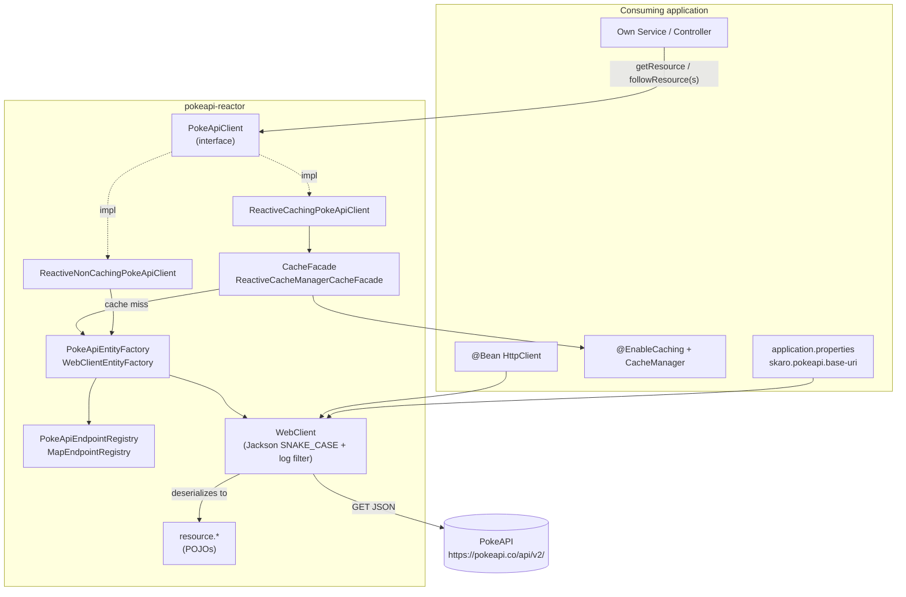

**General flow:** the app only knows about `PokeApiClient`. The concrete implementation (with or without caching) is decided by **which `@Configuration` is imported**. Both implementations delegate the HTTP work to `PokeApiEntityFactory`, which resolves the path via `PokeApiEndpointRegistry` and executes the request through `WebClient`.

---

## 5. Spring configuration and bean wiring

### 5.1 `@Import` hierarchy

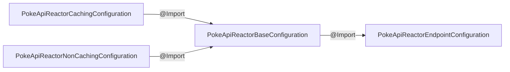

### 5.2 Registered beans

| Configuration | Bean | Name / Qualifier | Dependencies |
|---|---|---|---|
| Base | `PokeApiConfigurationProperties` | — (`@ConfigurationProperties("skaro.pokeapi")`, `@Valid`) | — |
| Base | `Jackson2JsonDecoder` | `pokeapiDecoderBean` | — |
| Base | `Jackson2JsonEncoder` | `pokeapiEncoderBean` | — |
| Base | `WebClient` | `pokeapiWebClientBean` | `HttpClient` (**from the app**), encoder, decoder, properties |
| Base | `PokeApiEntityFactory` → `WebClientEntityFactory` | — | `WebClient`, `PokeApiEndpointRegistry` |
| Endpoint | `PokeApiEndpointRegistry` → `MapEndpointRegistry` | — | — (45 hardcoded entries) |
| Caching | `CacheFacade` → `ReactiveCacheManagerCacheFacade` | `pokeApiReactorCacheFacade` | `CacheManager` (**from the app**) |
| Caching | `PokeApiClient` → `ReactiveCachingPokeApiClient` | — | `PokeApiEntityFactory`, `CacheFacade` |
| NonCaching | `PokeApiClient` → `ReactiveNonCachingPokeApiClient` | — | `PokeApiEntityFactory` |

### 5.3 Bean dependency graph

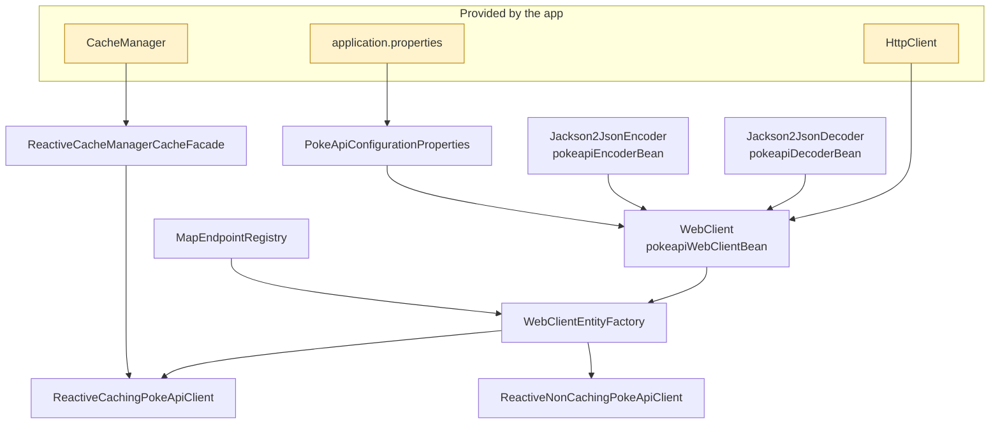

### 5.4 `WebClient` configuration

```java
WebClient.builder()
    .clientConnector(new ReactorClientHttpConnector(httpClient))   // HttpClient from the app
    .baseUrl(configurationProperties.getBaseUri().toString())       // skaro.pokeapi.base-uri
    .defaultHeader(CONTENT_TYPE, APPLICATION_JSON)
    .exchangeStrategies(strategies)                                 // Jackson SNAKE_CASE
    .filter(logRequest)                                             // log "GET <url>" (INFO)
    .codecs(c -> c.defaultCodecs().maxInMemorySize(maxBytesToBuffer)) // default 565_000
    .build();
```

### 5.5 Properties

| Property | Field | Default | Required |
|---|---|---|---|
| `skaro.pokeapi.base-uri` | `URI baseUri` | — | Yes (`@NotNull`) |
| `skaro.pokeapi.max-bytes-to-buffer` | `int maxBytesToBuffer` | `565000` | No |

> ⚠️ The README documents `skaro.pokeapi.max-buffer-size`, which **does not exist**. The correct property is `max-bytes-to-buffer`.

---

## 6. Class diagram — core (client + cache)

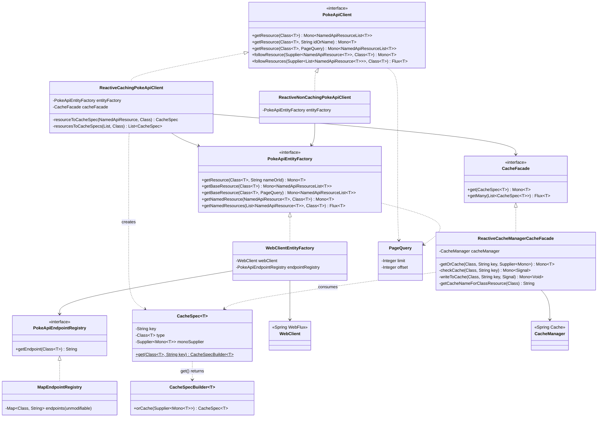

**Key type constraint:** every generic method uses `<T extends PokeApiResource>`. A model class that does **not** implement `PokeApiResource` cannot be passed to the client (compile-time error). See [§12](#12-observations-bugs-and-detected-limitations).

---

## 7. Class diagram — resource model

### 7.1 Base types

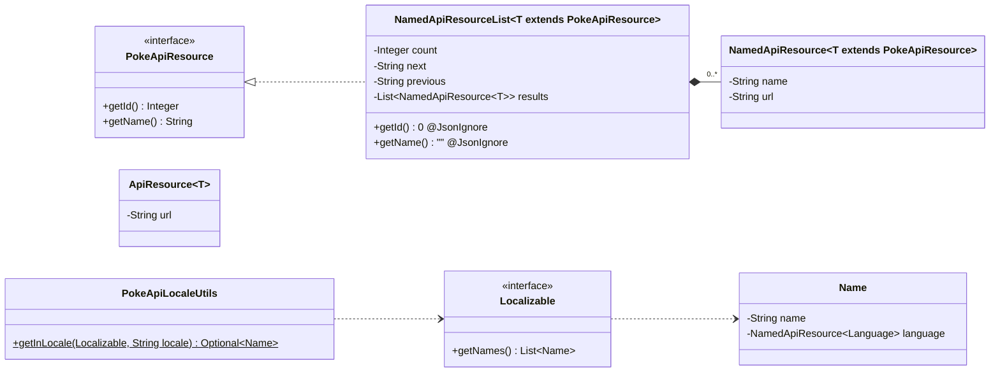

- **`NamedApiResource<T>`** is a *typed link*: it has a `name` and a `url`, and the type parameter `T` indicates which resource it points to. This is what gets passed to `followResource`.
- **`ApiResource<T>`** is a link **without a name** (only `url`). It is not compatible with `followResource` (which requires `NamedApiResource`).
- **`NamedApiResourceList<T>`** implements `PokeApiResource` only so that it can flow through the `CacheFacade` (hence `getId()=0` and `getName()=""`).

### 7.2 Pokémon aggregate (the most used resources)

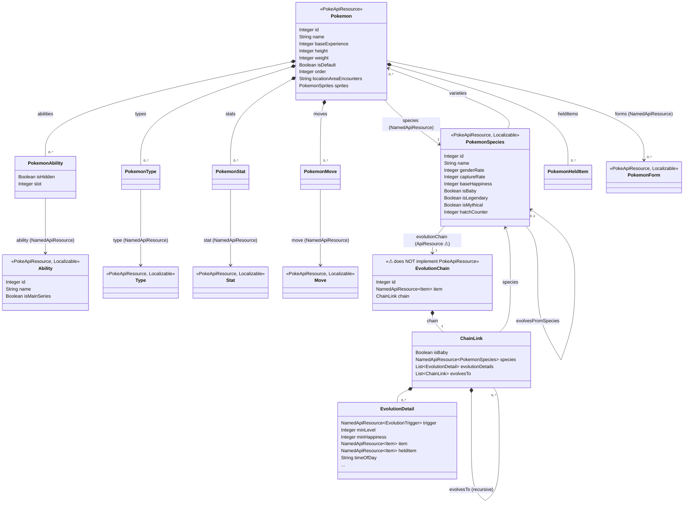

**Typical navigation:**
`Pokemon` →(`species`)→ `PokemonSpecies` →(`evolutionChain`, URL)→ `EvolutionChain` → `ChainLink` (recursive tree via `evolvesTo`).

### 7.3 Registered endpoints (`MapEndpointRegistry`)

45 `Class → path` entries. The 6 marked with ⚠ **do not implement `PokeApiResource`** and therefore cannot be used with `PokeApiClient` even though they are registered.

| Class | Path | | Class | Path |
|---|---|---|---|---|
| `Ability` | `ability` | | `Move` | `move` |
| `Berry` | `berry` | | `MoveAilment` | `move-ailment` |
| `BerryFirmness` | `berry-firmness` | | `MoveCategory` | `move-category` |
| `BerryFlavor` | `berry-flavor` | | `MoveDamageClass` | `move-damage-class` |
| `Characteristic` ⚠ | `characteristic` | | `MoveLearnMethod` | `move-learn-method` |
| `ContestEffect` ⚠ | `contest-effect` | | `MoveTarget` | `move-target` |
| `ContestType` | `contest-type` | | `Nature` | `nature` |
| `EggGroup` | `egg-group` | | `Pokedex` | `pokedex` |
| `EncounterCondition` | `encounter-condition` | | `Pokemon` | `pokemon` |
| `EncounterConditionValue` | `encounter-condition-value` | | `PokemonColor` | `pokemon-color` |
| `EncounterMethod` | `encounter-method` | | `PokemonForm` | `pokemon-form` |
| `EvolutionChain` ⚠ | `evolution-chain` | | `PokemonHabitat` | `pokemon-habitat` |
| `EvolutionTrigger` | `evolution-trigger` | | `PokemonShape` | `pokemon-shape` |
| `Gender` ⚠ | `gender` | | `PokemonSpecies` | `pokemon-species` |
| `Generation` | `generation` | | `Region` | `pokemon-region` ⚠ (path) |
| `GrowthRate` | `growth-rate` | | `Stat` | `stat` |
| `Item` | `item` | | `SuperContestEffect` ⚠ | `super-contest-effect` |
| `ItemAttribute` | `item-attribute` | | `Type` | `type` |
| `ItemCategory` | `item-category` | | `Version` | `version` |
| `ItemFlingEffect` | `item-fling-effect` | | `VersionGroup` | `version-group` |
| `ItemPocket` | `item-pocket` | | `Language` | `language` |
| `Location` | `location` | | `LocationArea` | `location-area` |
| `Machine` ⚠ | `machine` | | | |

---

## 8. Sequence diagrams

### 8.1 Bootstrap — how an app brings up the client

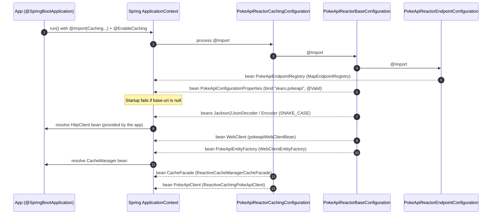

### 8.2 `getResource(Pokemon.class, "pikachu")` — **without caching**

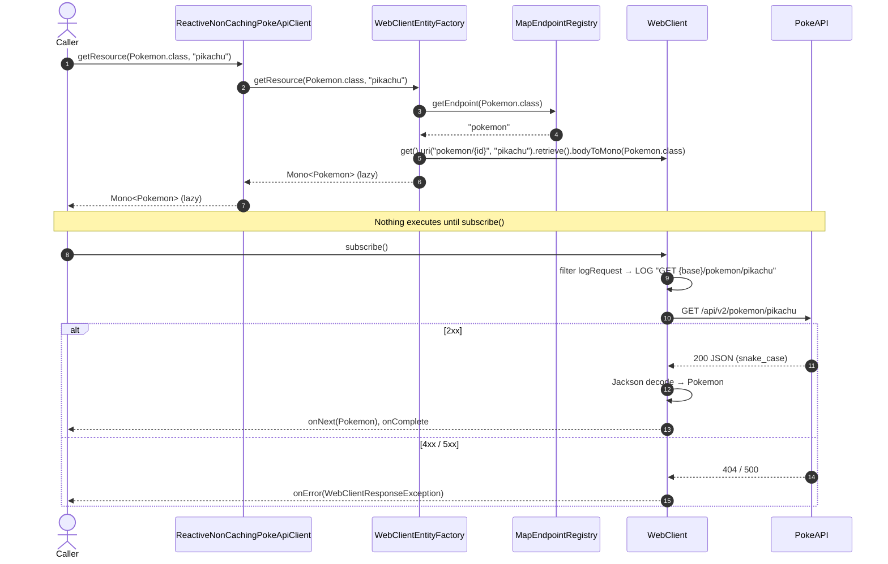

### 8.3 `getResource(Pokemon.class, "pikachu")` — **with caching** (miss and hit)

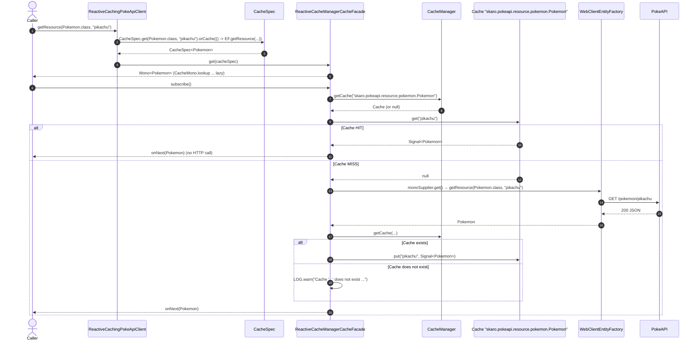

**Relevant details:**
- **Cache name** = the class's FQCN (`Class.getName()`).
- **Key** = the `idOrName` exactly as received (`"pikachu"` and `"25"` are distinct entries).
- **Stored value** = a Reactor `Signal<T>`, not the raw POJO.

### 8.4 `followResources(pokemon::getForms, PokemonForm.class)` — with caching

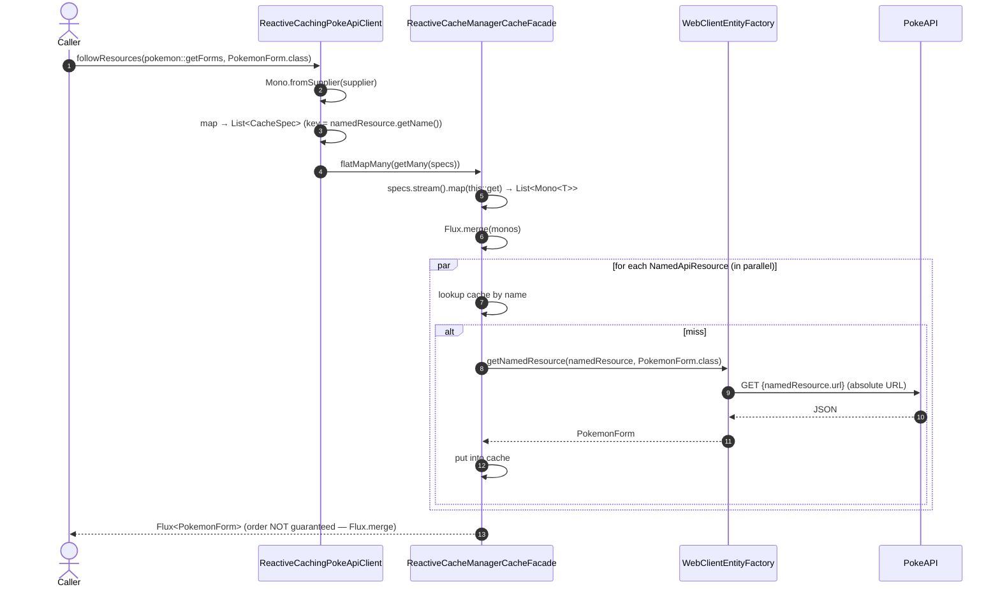

> `followResource` (singular) works the same way but with a single `CacheSpec` and `flatMap(cacheFacade::get)`.
> In the **non-caching** version, `followResources` delegates to `EF.getNamedResources`, which also uses `Flux.merge`.

### 8.5 Paginated listing `getResource(Pokemon.class, new PageQuery(20, 40))`

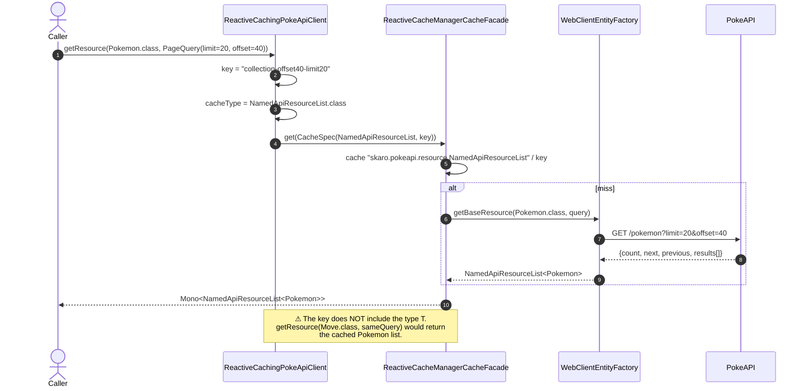

### 8.6 Composite use case — Pokémon → Species → Evolution chain

A flow that would require a business layer to obtain a Pokémon's evolution. It shows the current limitation of the model.

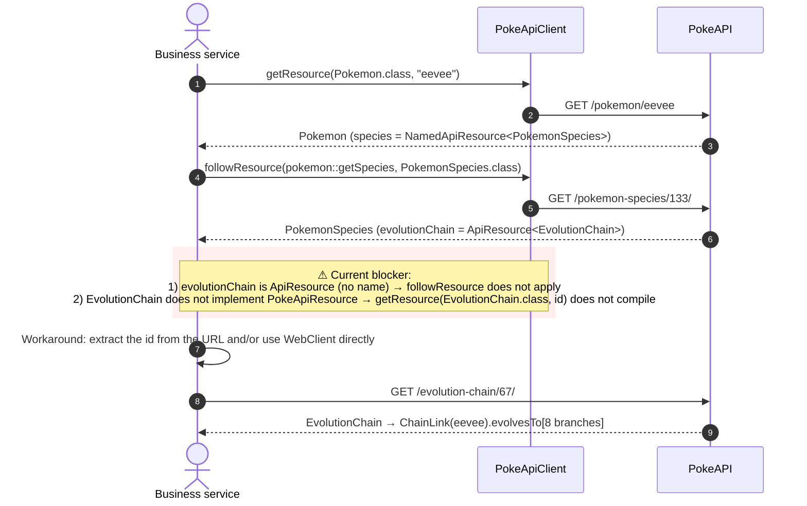

---

## 9. Design patterns applied

| Pattern | Where | Purpose |
|---|---|---|
| **Facade** | `PokeApiClient` | Single entry point; hides HTTP, caching, and registry. |
| **Facade** | `CacheFacade` | Isolates the client from `CacheManager` / `CacheMono`. |
| **Strategy** (via configuration) | `ReactiveCaching…` vs `ReactiveNonCaching…` | Same interface, interchangeable behavior depending on `@Import`. |
| **Decorator** (conceptual) | `ReactiveCachingPokeApiClient` | Adds caching around `PokeApiEntityFactory`. |
| **Factory** | `PokeApiEntityFactory` | Creates entity instances from HTTP + JSON. |
| **Registry** | `PokeApiEndpointRegistry` | Maps Java type → REST path; avoids scattered strings. |
| **Builder** (fluent) | `CacheSpec.get(...).orCache(...)` | Expresses "get X or cache whatever this supplier returns." |
| **Cache-aside / read-through** | `ReactiveCacheManagerCacheFacade` | Lookup → miss → fetch → write. |
| **Lazy evaluation** | The whole client (`Mono`/`Flux`, `Supplier`) | Nothing executes until `subscribe()`. |
| **Type-safe links** | `NamedApiResource<T>` | The target resource's type travels in the generic. |
| **Programming against interfaces** | `client`, `cache` | Eases mocking in tests and extension. |

---

## 10. Test strategy

| Test | SUT | Technique | What it validates |
|---|---|---|---|
| `WebClientEntityFactoryTest` | `WebClientEntityFactory` | **OkHttp `MockWebServer`** + real `WebClient` | Path, query params, HTTP method, deserialization |
| `ReactiveCachingPokeApiClientTest` | `ReactiveCachingPokeApiClient` | Mockito (`EntityFactory`, `CacheFacade`) + `ArgumentCaptor<CacheSpec>` | Correct `CacheSpec` keys/types and that the supplier calls the factory |
| `ReactiveNonCachingPokeApiClientTest` | `ReactiveNonCachingPokeApiClient` | Mockito | Correct delegation to the factory |
| `ReactiveCacheManagerCacheFacadeTest` | `ReactiveCacheManagerCacheFacade` | Mockito (`CacheManager`, `Cache`) | Cache hit, miss, nonexistent cache, `getMany` |
| `PokeApiLocaleUtilsTest` | `PokeApiLocaleUtils` | Pure unit | Looking up a `Name` by locale |

- All of them use **`StepVerifier`** (reactor-test) to assert on `Mono`/`Flux`.
- **There are no integration tests** (no full Spring context is started, and no calls hit the real PokeAPI).
- **There are no tests for the `@Configuration` classes** (also excluded from JaCoCo).

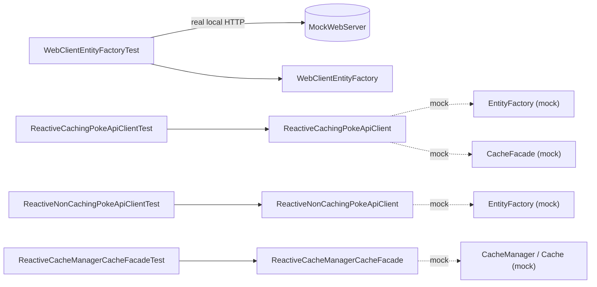

---

## 11. Build, CI/CD, and local execution

### 11.1 Pipelines (GitHub Actions)

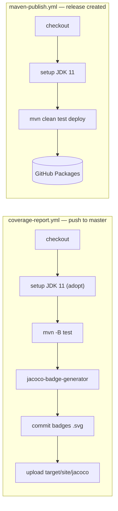

### 11.2 Running locally

**Requirements:** JDK 11 (via `jenv local 11`). Avoid JDK ≥ 17/21: JaCoCo 0.8.7 does not support those bytecode versions.

```bash
cd pokeapi-reactor
java -version                 # 11.x
chmod +x mvnw                 # if you get "Permission denied"
./mvnw -B clean test          # compiles + runs tests + JaCoCo report
open target/site/jacoco/index.html
./mvnw clean install          # installs 1.0.7 into ~/.m2 to consume it from another project
```

Since this is a library, **there is nothing to "run."** To execute it you need a host app (see §1), or you would need to add a `@SpringBootApplication` and remove `<skip>true</skip>` from the `spring-boot-maven-plugin`.

---

## 12. Observations, bugs, and detected limitations

| # | Severity | Location | Description |
|---|---|---|---|
| 1 | 🔴 High | `EvolutionChain`, `Characteristic`, `ContestEffect`, `Gender`, `Machine`, `SuperContestEffect` | **Do not implement `PokeApiResource`.** They are registered in `MapEndpointRegistry`, but `PokeApiClient.getResource(EvolutionChain.class, id)` **does not compile** because of the `<T extends PokeApiResource>` bound. This blocks querying evolution chains via the client. |
| 2 | 🔴 High | `PokemonSpecies.evolutionChain` | It is `ApiResource<EvolutionChain>` (only `url`), not a `NamedApiResource`. `followResource` does not accept it. Also, `ApiResource<T>` does not constrain `T`. |
| 3 | 🔴 High | `ReactiveCachingPokeApiClient.getResource(cls)` and `getResource(cls, PageQuery)` | **Cache collision:** the cache name is `NamedApiResourceList` and the key (`"collection"` / `"collection-offsetX-limitY"`) **does not include the type**. `getResource(Pokemon.class)` and `getResource(Move.class)` share an entry → the wrong list gets returned. |
| 4 | 🟠 Medium | `EvolutionChain.item` | Likely incorrect mapping: PokeAPI's JSON uses `baby_trigger_item`; with SNAKE_CASE, the `item` field is always `null` (to be verified against the real response). |
| 5 | 🟠 Medium | `PokeApiReactorEndpointConfiguration` | `Region.class → "pokemon-region"`; PokeAPI's actual endpoint is `region` (to be verified). |
| 6 | 🟠 Medium | `WebClientEntityFactory` | No error handling (`retrieve()` without `onStatus`), no timeouts, no retry. A 404 propagates as `WebClientResponseException.NotFound`. |
| 7 | 🟡 Low | Cache | Stores a `Signal<T>` (a Reactor type) → fine for in-memory caches (ConcurrentMap, Caffeine), problematic for serialized caches (Redis). No own TTL: depends on the `CacheManager`. |
| 8 | 🟡 Low | Cache | Key = literal `idOrName` → `"25"` and `"pikachu"` produce two entries for the same resource; `followResource` uses `name` as the key. |
| 9 | 🟡 Low | `followResources` / `getMany` | `Flux.merge` → the result order **does not** respect the order of the input list. Use `Flux.mergeSequential`/`concat` if order matters. |
| 10 | 🟡 Low | README | Documents `skaro.pokeapi.max-buffer-size` (nonexistent); the real one is `max-bytes-to-buffer`. |
| 11 | 🟡 Low | Dependencies | Spring Boot 2.4.3 (EOL), `PropertyNamingStrategy.SNAKE_CASE` deprecated (use `PropertyNamingStrategies`), `CacheMono` deprecated in reactor-extra, JUnit 4 `assertTrue` mixed with JUnit 5. |
| 12 | 🟡 Low | Logging | The log filter uses `LoggerFactory.getLogger(PokeApiEntityFactory.class)` and logs at INFO on **every** request. |
| 13 | ⚪ Info | Repo | `.DS_Store` not ignored; `.idea/gradle.xml` present in a Maven project. |

### Quick-fix suggestions (for #1–#3)

```java
// #1 — make EvolutionChain (and the other 5) implement PokeApiResource
public class EvolutionChain implements PokeApiResource {
    // ...
    @Override @JsonIgnore
    public String getName() { return String.valueOf(id); }
}

// #2 — helper to follow an ApiResource by URL (in PokeApiClient / EntityFactory)
<T extends PokeApiResource> Mono<T> followResource(ApiResource<T> resource, Class<T> cls);

// #3 — include the type in the listing key
String key = String.format("%s-collection-offset%d-limit%d", cls.getName(), query.getOffset(), query.getLimit());
```

---

## 13. Extension: Trainer domain — Pokémon Box & Active Party

> This section documents work on branch `feature/baul-equipo-pokemon`, applied **on top of** the client library described in §1–§12, which remains untouched. Design spec: [`docs/superpowers/specs/2026-10-15-baul-equipo-pokemon-design.md`](superpowers/specs/2026-10-15-baul-equipo-pokemon-design.md).

### 13.1 Purpose

`pokeapi-reactor` was, through §12, a reactive PokéAPI *client library* with no runnable entry point. This extension grows the project into a runnable application that implements a concrete business domain on top of that client: managing a trainer's individual Pokémon ("instances"), differentiating an **Active Party** (the Pokémon a trainer carries and can battle with) from a storage **Box** (everything else the trainer owns), backed by persistence and exposed through REST endpoints.

### 13.2 Hexagonal layering

New code lives under `skaro.pokeapi.trainer.{domain, application, adapter}`, following a hexagonal (ports-and-adapters) layering:

- **Domain** is pure and synchronous — it has no Spring or Project Reactor imports at all.
- The existing `PokeApiClient` is consumed **only** behind an outbound port, `PokemonCatalogPort`, implemented by the adapter `PokeApiCatalogAdapter`. This means the domain never depends on anything under `skaro.pokeapi.*`.
- Persistence sits behind another outbound port, `PokemonRepository`.

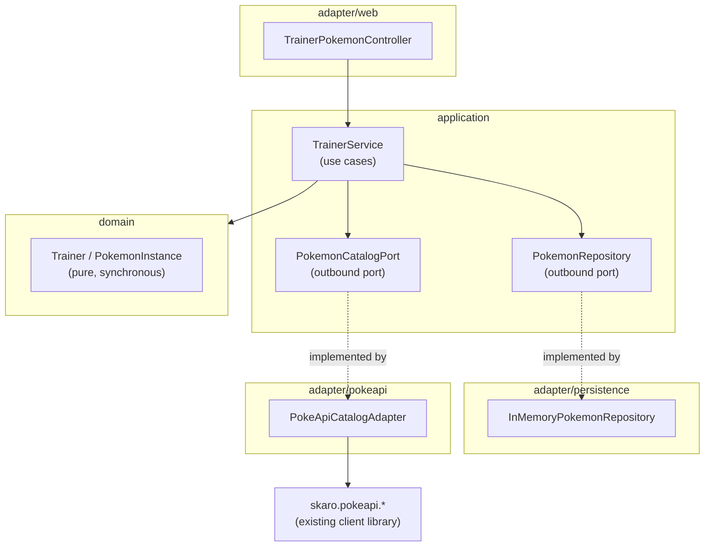

Package layout:

```
skaro.pokeapi.*              (existing client library, untouched)
skaro.pokeapi.trainer/
  ├─ domain/                 (Trainer aggregate, PokemonInstance, value objects, exceptions)
  ├─ application/            (TrainerService use cases; ports under application/port)
  └─ adapter/{web, persistence, pokeapi}
```

### 13.3 Domain model

`Trainer` is the **aggregate root**: it owns both the party and the box collections and enforces the storage invariants (capacity limits, no duplicate placement). Internally it uses a `LinkedHashMap<UUID, PokemonInstance>` for both collections, giving O(1) lookup by id while preserving slot order.

`PokemonInstance` is an entity with global `UUID` identity. Its `evolve()` operation produces the evolved form while preserving identity (the same `UUID`) and genetics (IVs/EVs/nature/gender/origin metadata carry over).

Self-validating value objects:

| Value object | Validates |
|---|---|
| `IndividualValues` | 6 IVs, each in `0..31` |
| `EffortValues` | 6 EVs, each in `0..252`, total ≤ 510 |
| `Nature` | one of the standard natures |
| `Moveset` | up to 4 unique moves |
| `HeldItem` | an optional single item |
| `SpeciesRef` | reference to a PokéAPI species |
| `OriginMetadata` | OT id, pokeball, capture date, initial level, origin location |

Supporting enums: `Stat`, `Gender`.

Storage limits are externalized and configurable via `StorageLimits` / `StorageProperties`: `trainer.party.max-size` (default `6`) and `trainer.box.max-size` (default `30`).

Typed domain exceptions map to HTTP status codes at the web adapter boundary (see §13.7).

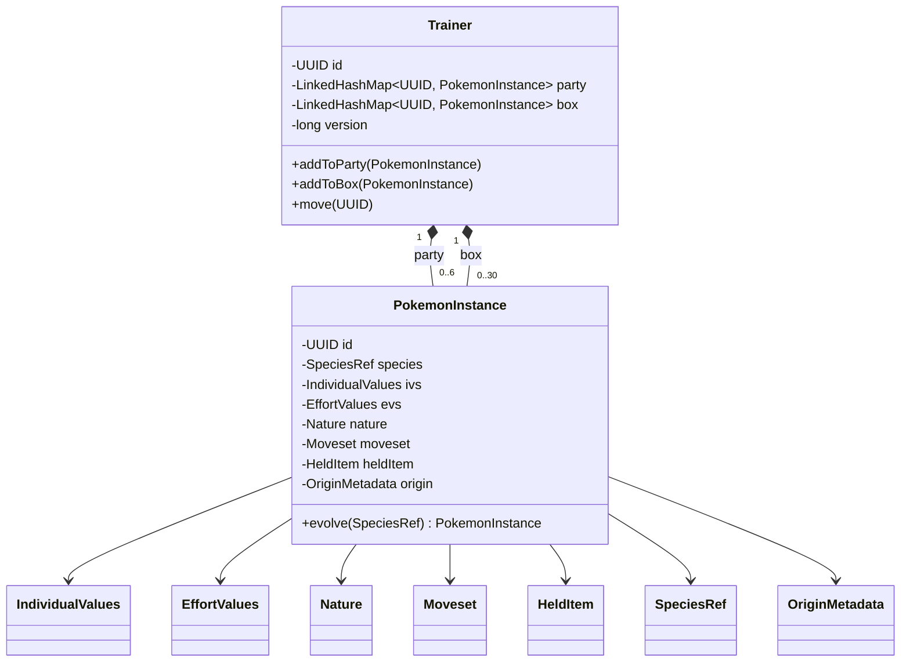

### 13.4 Persistence & concurrency

`InMemoryPokemonRepository` is a `@Repository` backed by a `ConcurrentHashMap`, implementing the `PokemonRepository` outbound port.

Concurrency safety is achieved with **optimistic locking**:
- **Copy-on-load** — reads return an isolated copy of the `Trainer` aggregate, so callers can never mutate shared state directly.
- A `version` field on `Trainer`, incremented on every successful mutation.
- **Compare-and-swap on save**, implemented via `ConcurrentHashMap.compute`; if the stored version does not match the version the caller loaded, the save throws `OptimisticLockException`.
- **Retry in the mutating use cases**: `Mono.defer(...).retryWhen(Retry.max(8)...)` re-runs load → mutate → save on an `OptimisticLockException`.

This keeps the party/box invariants correct under concurrent requests — no lost updates, and the capacity cap is never exceeded. When retries are exhausted, the failure surfaces as an HTTP 409 (Conflict). `MAX_RETRIES = 8` is a tuned ceiling: under extreme contention, returning 409 is considered the safe response rather than retrying indefinitely. A real database adapter (e.g. R2DBC or MongoDB) would apply the same optimistic-locking pattern using a version column/field instead of the in-memory `version` counter.

### 13.5 PokéAPI catalog adapter

`PokeApiCatalogAdapter` implements `PokemonCatalogPort` on top of the existing `PokeApiClient`. It maps the library's `Pokemon` resource into a `SpeciesData` DTO (abilities, types, base stats keyed by `Stat`, sprite), and walks the evolution chain to resolve `directEvolutionsOf` (used by the `evolve` use case).

**Known limitation:** the evolution chain is referenced from `PokemonSpecies` as an unnamed `ApiResource` (URL only — see §12, item 2). Following that reference bypasses the library's `CacheFacade` entirely, since `CacheFacade`/`followResource` only operate on `NamedApiResource`. As a consequence, every `evolve` call re-fetches the evolution chain from PokeAPI uncached.

### 13.6 Application use cases

`TrainerService` exposes the following use cases:

| Use case | Behavior |
|---|---|
| `capture` | Resolves and validates the species/ability against PokéAPI **first**; only then builds the pure-domain `PokemonInstance` and auto-places it, preferring the party and falling back to the box when the party is full. |
| `getInstance` | Returns a single stored instance. |
| `listParty` | Composite read: merges stored instance metadata with live PokéAPI species data. |
| `listBox` | Lists box contents. |
| `move` | Moves an instance between party and box. |
| `evolve` | Validates the target species is a direct evolution of the current one, then swaps the ability and preserves id, slot, and genetics. |

Reactive pattern: asynchronous work (PokéAPI calls, repository I/O) stays at the edges of each use case; the pure domain logic is invoked synchronously once the required data has been resolved.

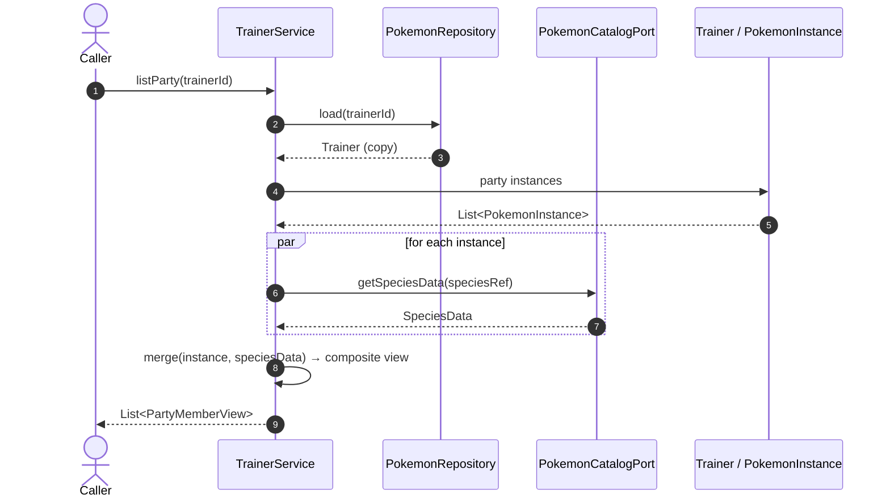

### 13.7 REST API & errors

Base path: `/api/v1/trainers/{trainerId}`, exposed by `TrainerPokemonController`.

| Method | Path | Purpose | Key status codes |
|---|---|---|---|
| `POST` | `/pokemon` | Capture a Pokémon into party/box | `201 Created` |
| `GET` | `/pokemon/{id}` | Fetch a single instance | `200 OK`, `404 Not Found` |
| `GET` | `/party` | Composite party view (instance + live species data) | `200 OK` |
| `GET` | `/box` | List box contents | `200 OK` |
| `PATCH` | `/pokemon/{id}` | Move an instance between party and box | `200 OK`, `404 Not Found`, `409 Conflict`, `422 Unprocessable Entity` |
| `POST` | `/pokemon/{id}/evolve` | Evolve an instance into a direct evolution | `200 OK`, `404 Not Found`, `409 Conflict`, `422 Unprocessable Entity` |

Errors are centralized in `ApiExceptionHandler` (`@RestControllerAdvice`), which maps typed domain exceptions to `application/problem+json` responses in three groups: `404` (not found), `409` (conflict — e.g. optimistic-lock retries exhausted, duplicate placement), and `422` (semantic validation failures — e.g. invalid IVs/EVs, non-direct evolution target, full storage).

### 13.8 Developer aids

- Annotated OpenAPI/Swagger UI, wired via `springdoc-openapi-webflux-ui` and configured in `OpenApiConfig`, exposed at `/swagger-ui.html` and `/v3/api-docs`. Both are served locally and require no internet access.
- `docs/api-examples.http` — ready-to-run HTTP requests for manual exercising of the API.
- `docs/smoke-test.sh` — a shell script for manual end-to-end smoke testing.

### 13.9 Testing

The test suite spans multiple levels:

- **Domain unit tests** — pure, with no Spring context involved.
- **`StepVerifier`** — for reactive flows in the application layer.
- **`WebTestClient`** — for the web adapter layer.
- **`mockwebserver`** — for the PokéAPI catalog adapter.
- **Concurrency stress test** — a 20-thread test that exercises concurrent mutations against the same trainer and proves the party/box invariants hold under contention (no lost updates, capacity never exceeded).

Full suite: **67 tests**.
